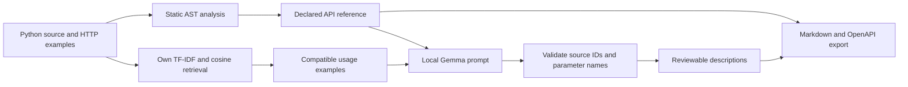

# API Notes: API Documentation Generator

**ILLM Project 31 · Vishal Gautam · U23AI127 · SVNIT Surat**

The selected topic is **API Documentation Generator**: developers spend time writing documentation, so build an LLM that generates API docs directly from source code and usage examples.

API Notes reads Python API source, extracts a source-backed reference, retrieves compatible usage examples, and uses local Gemma to draft endpoint descriptions. Every endpoint links to its original handler and relevant model definitions. Export the result as Markdown or OpenAPI 3.1 JSON.

Request and response models are shown as field tables with types, required fields, defaults and constraints. Array responses identify their item fields. The model indicator distinguishes Ollama being unavailable, a missing model, a busy generation and readiness, refreshes every five seconds, and offers **Recheck model**. Generation is rejected before starting a job when the model is unavailable; source analysis and existing exports remain available.

## Run

Use Python 3.13 or newer. The application uses the Python standard library, so there are no runtime packages to install.

To clone the project:

```powershell
git clone https://github.com/vkg6835/api-documentation-generator.git
cd api-documentation-generator
```

```powershell
py -3.13 run_demo.py
```

Or double-click **Start Demo.bat**. Keep the terminal open. The launcher opens `http://127.0.0.1:8000`; if that port is occupied, run `py -3.13 run_demo.py --port 8010`.

For new LLM descriptions, [Ollama](https://ollama.com) must be running with `gemma:2b` installed. Check with `ollama list`. This laptop already has that model. On another computer, install Ollama and run `ollama pull gemma:2b`.

```powershell
$env:OLLAMA_MODEL = 'gemma:2b'
py -3.13 run_demo.py
```

The source-derived reference works without Ollama. The first local generation may take longer while the model loads. Completed drafts are saved in a local SQLite database. A checked, actual Bookstore generation is included in `artifacts/demo_llm_output.json` for the seeded demo.

## Demonstrate one endpoint

1. Select **Bookstore · FastAPI**, then **Generate API reference**.
2. Open `POST /v1/books`. Its declared body is `BookCreate`, and the success status is `201`.
   Show **Request and response fields**: the title length is 1–120, the minimum price is 0, and `published` defaults to false. These fields come from the source schema.
3. Open **Source evidence**. The handler allocates an ID, constructs a dictionary, saves it in the in-memory `BOOKS` catalog, and returns that full record.
4. Open **Usage examples** to inspect the supplied POST request and JSON body.
5. Click **Draft this description**. Gemma explains that visible behavior using the handler, model definitions, and matching request.
6. Download Markdown and OpenAPI. The contract and source references are preserved in both.
7. Show **Evaluation** and explain the comparison limits.

The authorship and evaluation notes are in [docs/Professor_Expectations.md](docs/Professor_Expectations.md). [SHOW_DEMO.md](SHOW_DEMO.md) contains a short viva script.

[docs/Presentation_Demo.md](docs/Presentation_Demo.md) is a three-minute presentation walkthrough and rehearsal checklist. The Inventory sample adds a duplicate-SKU 409 case; it is included in the expanded LLM study, separately from the original route/retrieval benchmark.

## Pipeline



Submitted code is parsed, not imported or executed. The generator's own web server uses the standard library. FastAPI and Flask occur in the source inputs; they are not required to run this generator.

## Supported inputs

- `.py` files containing literal FastAPI/APIRouter or Flask/Blueprint routes.
- Ordinary imports and static router mounting, including prefixes and imported router aliases.
- Typed path/query/body parameters, simple `Annotated` declarations, required/default values, and common validation constraints.
- Basic directly declared Pydantic `BaseModel` fields and response-model references.
- Explicit `HTTPException` and `abort` status codes and simple Flask success-status tuples.
- `.http`, `.rest`, or `.txt` request examples using a method and URL. Start each request block with `### EX-unique-id | Description`.

Supply the files needed to resolve imports and router mounting. Maximum: 30 files and 500 KB combined. Uploaded names are relative labels; they are never used to read arbitrary local files.

Examples are ranked using TF-IDF, then checked against the endpoint's HTTP method and route template. They are source-supplied examples and are not executed.

## Own work and external components

| Component | Implementation |
|---|---|
| Route and model analysis | Own workflow over Python's standard AST parser |
| Router/prefix resolution | Own import and mounting resolution |
| Representation and retrieval | Own sparse TF-IDF, word/bigram/character features, L2 normalization and cosine similarity |
| Metrics | Own precision, recall, F1, hit@1, hit@3 and MRR@3 calculations |
| LLM integration | Own source/example prompt, constrained JSON and validation layer |
| Documentation | Own Markdown/OpenAPI exporters, source attribution, revision comparison and interface |
| Language model | Existing pretrained `gemma:2b`, run locally through Ollama; no training or fine-tuning claimed |

The LLM supplies prose. It cannot overwrite the separately extracted methods, paths, types and declared status codes. The validator checks source IDs, example IDs, parameter names, field shapes and text limits. It does not prove that every generated statement is true.

## Actual evaluation

```powershell
py -3.13 -m unittest discover -s tests -v
node tests/frontend_smoke.cjs
py -3.13 scripts/evaluate.py
py -3.13 scripts/evaluate.py --llm
py -3.13 scripts/compare_llm.py --report
py -3.13 scripts/rehearse_demo.py --url http://127.0.0.1:8010
```

`evaluation/gold.json` contains independent, manually annotated expected routes and retrieval-query labels. The examples are authored fixtures, not a public benchmark.

- Static analysis recovers all **10** annotated method/path pairs. The local-decorator regex baseline recovers **1**. The fixtures include prefixed routers/blueprints and an unprefixed health route.
- Four development queries select the retrieval feature setting before twelve held-out paraphrases are evaluated. All feature modes use the same example index and queries.
- The selected unigram configuration gets **83.33% hit@1** and **100% hit@3** on those twelve test queries. Character features get 100% hit@1 on this small test set, but test results are not used to select the runtime configuration.
- `artifacts/llm_comparison.json` contains two actual Gemma outputs for the same POST endpoint: source only and source plus usage context. The source-only draft incorrectly claims that only an ID is returned; the grounded draft describes the returned record. This is a case study, not a general quality score.
- The expanded comparison records **16 actual generations for eight endpoints across three sample APIs** in `artifacts/llm_suite.json`. `evaluation/llm_cases.json` defines essential facts and a 0–2 rubric. `evaluation/llm_review.json` contains an explicit assistant review of each output, bound to the captured inputs and outputs with hashes. The interface displays full recorded outputs and their source context.
- In that assistant review, both settings average **1.50/2 correctness** and **1.00/2 completeness**, with four flagged unsupported claims each. Source-only clarity is 1.88/2 and source-plus-usage clarity is 1.50/2. Usage context corrects the Bookstore return-value error but does not establish a consistent quality benefit across these cases. These are assistant assessments on small authored samples, not independent human ratings.

To repeat the expanded run, execute `py -3.13 scripts/compare_llm.py --generate`, review every new output against its source and the predefined rubric, then update the review file and run `--report`. Regeneration invalidates the previous reviews; the app shows a pending review instead of reusing stale scores. See [docs/Evaluation_Method.md](docs/Evaluation_Method.md) for the full method.

All **30 Python tests** passed after this update. They check routing, schema constraints, examples, source-only parsing, mathematical calculations, validation, persistence, exports, revision comparison, readiness errors and comparison review integrity. Frontend smoke checks exercise pages, tabs, schema fields and array responses, readiness transitions, comparison rendering and HTML escaping; they are not visual browser tests. The live HTTP rehearsal also passed source loading, actual Gemma generation, both downloads, the Inventory 409 case and the expanded evaluation. It checks the workflow and extracted contract, not prose factuality. Browser rehearsal was blocked by the computer-use URL verification, so a manual visual walkthrough remains pending.

## Limits

This first version supports common Python API declarations. JavaScript/Express, dynamic route construction, custom decorator wrappers, inherited/custom Pydantic behavior and middleware-level authentication are not fully reconstructed. Untyped response bodies and dynamically read request bodies remain unknown unless explicitly declared. Review generated explanations against the code.

OpenAPI output is a static draft, not the framework's runtime schema. In particular, complex form/file inputs, `Body(embed=True)`, aliases, conditional mounts and duplicate model names require review. Sources and warnings remain available for that purpose.

There is no execution of uploaded code, no online model API key, no bank-related functionality, and no claim of broad API-documentation accuracy. Future work should evaluate a larger independently annotated API set and compare LLM factuality using human-reviewed criteria.

## Code map

| File | Responsibility |
|---|---|
| `app/parser.py` | Source facts, routes, model schemas and evidence |
| `app/retrieval.py` | Feature extraction, own TF-IDF, cosine similarity and HTTP examples |
| `app/engine.py` | Workflow, example compatibility, exports and revision comparison |
| `app/llm.py` | Local generation and provenance validation |
| `app/quality.py` | Comparison summaries and validation of matching reviews |
| `app/storage.py` | SQLite records and transactional updates |
| `app/server.py` | Local web API and generation jobs |
| `scripts/evaluate.py` | Reproducible comparisons and actual LLM output capture |
| `scripts/compare_llm.py` | Eight-endpoint generation capture and reviewed reports |
| `static/` | Local web interface |
| `examples/` | Authored FastAPI and Flask inputs |
